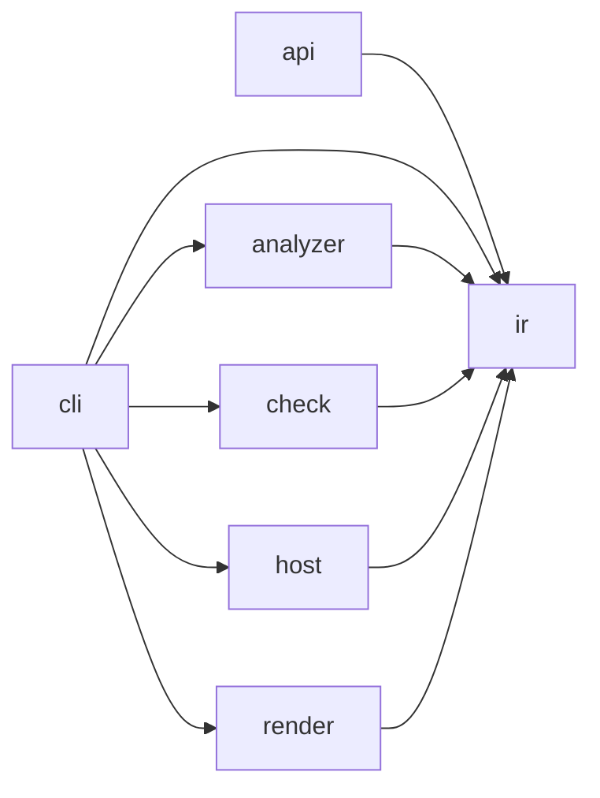

# Compact Target definition scope

Status: contracts, two code boundaries and bounded reliability fixes implemented;
full architecture acceptance remains open.
Baseline: `006bc089852a80bd60f8723e2c4b4f9bfb6d1210`.
The earlier experiment at `2378c9006390f40d63f2948a0eff4ed0e3f895b4` is retained
on `feat/detailed-target-architecture-experiment`; PR #604 is rebuilt from the baseline.

## Goal and scope

Implement the compact target contracts and align production code with them in
PR #604, preserving supported behavior, conservative evidence and all existing
rule meanings. Contract definition is the first milestone; complete code alignment
and validation in the same PR are the end goal. The two implemented boundary
refactorings are a milestone, not evidence of complete architecture conformance.
Do not merge automatically.

Keep the baseline's root and eight nested contracts. Refine existing owners and
actual crossing ports; do not add a parallel source inventory or prescribe a
package migration. Preserve required entities, allowances and acceptance budgets.
The original 59 positions are reconciled below; required proof gaps remain open.

Basis: [AD-17](../decisions/ad-17-archkeels-own-target-names-its-quality-goals-and-ir-holds.md),
[adapter target](../language-adapter-target.md) and
[AD-213](../decisions/ad-213-renderer-responsibility-boundaries.md).
Responsibility refinements and new constraints are agent decisions. Existing
permission authorship remains recorded in its original entries. Existing imports identify consumers;
they do not authorize dependencies. The previous implementation does not approve
its own design decisions.

## Responsibilities

Keep the seven established outer owners and their permitted directions:

| Owner | Owns | Excludes |
| --- | --- | --- |
| `api` | Read a saved report through the stable external Python API. | Rule decisions and a second decoder. |
| `cli` | Decode arguments/configuration, inject adapters, publish returned files. | Parsing source, evaluating rules and duplicating workflows. |
| `analyzer` | Collect source facts through bounded language processes. | Reading architecture policy and executing the analyzed project. |
| `check` | Authenticate inputs, assemble observations, apply declared rules. | Rendering and selecting concrete collector/forge implementations. |
| `host` | Acquire forge evidence and disclose authentication/ordering gaps. | Architecture verdicts and acceptance decisions. |
| `ir` | Typed values, strict codecs, pure evidence derivations. | I/O, except the existing checker-source identity boundary. |
| `render` | Explain results in HTML, terminal output and offline scenes. | Re-evaluating rules and treating display filters as proof. |

Refine the existing inner owners at these seams:

| Seam | Responsibility and dependency direction |
| --- | --- |
| IR facts / protocol / codecs | Facts describe measurements; protocol owns process envelopes; codecs validate and convert bytes. Codecs consume typed values and do not acquire inputs or decide verdicts. |
| IR governance | Distinguish local value invariants, wire conversion, graph/metric derivation and projections. Pure command-view preparation remains part of result composition ([AD-238](../decisions/ad-238-command-view-preparation.md), [AD-239](../decisions/ad-239-codec-format-owners.md)); it does not evaluate policy. Do not mandate seven new physical packages. |
| Check inputs / declarations | Inputs acquire immutable source/runtime/host evidence; declarations authenticate contract/UML intent. Neither decides rule verdicts; declarations do not depend on evaluation. |
| Check observation / evaluation | Observation assembles facts and intent once; evaluation applies rules. One evaluator per rule; no permissions inferred from imports. |
| Check regression / workflows / validation | Regression compares bound revisions; workflows coordinate commands; validators return diagnostics. Shared operations sit below command peers; no forwarding service layer. |
| Type-boundary evaluation | Interpretation depends on binding lookup; assessment consumes interpreted types and exact allowance matching. Keep recursive interpretation together and reuse one named-type resolver. |
| Python source / binding / member proof | AST and lexical identity precede binding proof; member proof consumes proven identities. Specialist collectors emit facts, not architecture policy. |
| Dart / TypeScript | Keep their established input, syntax, configuration/snapshot, resolution and collection owners. Split only for an independently useful operation. |
| CLI arguments / installer / composition | Decode input, install requested resources and wire dependencies respectively. Installation does not evaluate repository policy. |
| Render payload / summary / HTML / terminal | Payload projects evidence; summary explains results; HTML and terminal compose output. Payload and summary do not depend on HTML. |
| Browser projection / layout / Explorer | Projection builds scenes; layout places/routes them; Explorer owns DOM, navigation, focus and input lifetime. Generated runtime and vendored ELK are outputs/dependencies. |

A new `inside` boundary needs an independent change reason, a crossing worth
constraining and a useful negative control. File size alone does not justify it.
Keep decision ownership at one contract level; do not copy every child API upward.
Compatibility bridges constrain migration, not the permanent responsibility model.

## Reviewed physical scope

The recursive structure review inventories all 144 maintained Python modules,
including initializers, plus authored browser assets. It checks module responsibilities,
imports, declared owners and direct I/O sites; it does not prove every function body
correct. Counts below exclude initializers. A large count triggers review, not a split.
Empty experiment directories are not source packages.

| Reviewed subtree | Direct modules / subpackages | Actual review depth and decision |
| --- | --- | --- |
| `api.py` | 1 / 0 | Read the complete reader path through file read, strict decoding and violation projection. Keep this stable I/O edge; exact import ports and signature are native intent. |
| `analyzer` | 4 / 3 | Structural review and process-protocol target review; process internals need their existing safety suites. Keep runtime/bootstrap above isolated language adapters. |
| `analyzer/python` | 17 / 0 | Traced collector assembly and source-owned definition contexts into symbol/call evidence; other specialist bodies structurally reviewed. Keep source/binding/member foundations below isolated collectors. No contexts module is needed. |
| `analyzer/dart` | 6 / 0 | Structural review plus snapshot/syntax/resolution/collection declarations and ports; no new complete parser/resolver semantic review. Keep the five existing owners; file length alone does not justify a split. |
| `analyzer/typescript` | 7 / 0 | Structural review plus input/configuration/syntax/resolution port declarations; no new complete parser/resolver semantic review. Keep these independently changing owners. |
| `check` | 18 / 2 | Traced shared repository observation, UML authentication, report/saved-report boundaries and Check input ordering; remaining workflow helpers structurally reviewed. Keep shared observation below command consumers. |
| `check/evaluation` | 7 / 0 | Located coverage composition/profile-rule callers and reviewed responsibility placement; the recursive interpreter needs its separate proof review. `evaluate` composes coverage and `rules` owns availability; no coverage module is needed. |
| `check/validation` | 8 / 0 | Read public validation/error entry and containment handling; diagnostic modules structurally reviewed. Keep focused diagnostics under validation orchestration. |
| `cli` | 5 / 0 | Read parser construction, nominal input targets and adapter wiring; remaining dispatch/configuration bodies structurally reviewed. Keep typed choices in arguments and parser/configuration I/O in composition. |
| `host` | 1 / 0 | Read the complete environment/identity/subprocess/decode/record path. Keep forge acquisition outside Check; fail bounded requests through typed ordering errors. |
| `ir` | 52 / 0 | Structural/import/I/O review of every module; read non-use candidate derivation and codec/projection ownership decisions. Keep focused flat formats, values and pure derivations (AD-238/239); no speculative package migration. The digest reader is the documented I/O exception. |
| `render` | 6 / 0 | Read exact public ports and existing payload/summary direction constraints; HTML composition bodies structurally reviewed. Keep payload/summary below HTML and terminal. |
| `render/assets` | 11 authored / 0 | Read projection/layout ports, layout validation, Explorer async generation handling and their existing browser controls. Other UI paths structurally reviewed; Python rules do not scan these assets. |

The three generated outputs are `flow.runtime.js`, `report-graph-protocol.js` and
`report-graph-vocabulary.ts`; their authored sources are Flow, the TypeScript scene
protocol and canonical Python enums. The pinned
`elkjs-0.12.0.bundled.js` is vendored; icons, logos and CSS are presentation resources.
`make browser-runtime-check` verifies Terser publication and source identity, without
Flow typechecking. `make browser-graph-check` checks protocol generation and statically
checks graph-scene/deviation consumers, not report-scene, layout or Explorer dependencies.

Existing browser evidence is explicit: `test_report_renderer_units.py` covers pure
projection, input preservation and rejection of incomplete/duplicate/nonfinite layout
output; `test_uml_rendering.py::test_standard_uml_ignores_stale_layout_and_retries_rejected_layout`
covers async generation ownership and retries. Interactions and offline CSP have
separate suites. Native ArchKeel enforcement of these JavaScript boundaries remains
a capability gap; a Python PASS does not close it. An isolated TypeScript collector
probe read and parsed both unchanged `report-layout.js` and `report-scene.js` with
`allowJs`: two selected files, 35 symbols and zero imports. Their global IIFE ports
are not import edges; receiver dispatch remains unproven. One scan currently has one
language/namespace, so replacing the Python scan with this probe would lose its scope.
Failure/lifecycle meanings in port responsibilities likewise need behavior tests,
beyond matching signatures.

The Host acquisition contract bounds the `glab` request to 30 seconds, decodes UTF-8
explicitly and exposes timeout, decoding and execution failures as `OrderingError`.
Environment/commit validation precedes execution; Check owns acceptance of ordering
evidence. `test_host_gitlab.py` verifies these failure paths independently of native
signature checks. Captured output is still buffered; no output-size bound is claimed.

At the clean `173f5482` evidence revision, the 58 required UNKNOWNs comprise 30 type
positions, 20 facade routes and eight UML assessments. Fifteen routes reach unscanned
external exports (including pathlib, contextlib and Rich); five remain local alias
routes. Their public availability is not proof of their type shape. The native control
`test_boundary_types_chain_proof.py::test_unscanned_public_alias_is_unknown_beside_a_typed_function`
preserves this distinction. No export narrowing, scan reduction or allowance change
can close these required gaps; the final candidate must be measured again.

Replaying the actual checker and collector from `60eed561` reproduces all 59 original
required coordinates and record IDs (source digest
`c2e6ee4714eedba8b2b62c476ecdab5be428806b5fcac521417dca82a4efa366`).
The reconciliation is **59 − 2 + 1 = 58**: 57 positions remain; two abandoned
experimental constant targets (`OPAQUE_NATIVE_REASONS`, `BROAD_BOUNDARY_TYPES`)
left the compact scope; the retained report facade adds one `JsonValue` return
position. None is an evidence improvement. The 30 type positions are 29 alias
positions and one inherited `Mapping` surface; the other groups are 20 facade
routes and eight incomplete member inventories. Binding/source identity is not
static namespace proof. External declarations and browser script-global binding
remain native capability gaps, not reasons to whitelist dependencies.

No deletion follows from the unreferenced-symbol projection. It excludes known dynamic
interfaces and declared exports but cannot prove external or runtime non-use. The
report facade and codec aliases remain compatibility obligations; no dead-code removal
is claimed by this structure review.

## Interfaces

Specify exact crossing symbols, typed inputs/outputs, failure behavior and
compatibility in their authoritative native entries. These are the required seams:

| Crossing | Interface obligation |
| --- | --- |
| External caller → API | `load_violations(Path) -> tuple[ViolationRow, ...]`; preserve `ViolationRow`, `ViolationFingerprint` and existing read/decode errors. |
| CLI → Check | Existing `run_report`, `run_saved_report`, `run_check`, `run_validate`, `run_init`; retain `RunResult`, canonical bytes and `FilesToWrite` outputs. Distinguish invalid input, violations and missing evidence. |
| Check workflows → observation / Host ports | Existing `Analyzer` is the workflow observation callable returning `ObservationResult`; `Host` returns records or ordering evidence/error. Check does not import concrete adapters. Unauthenticated evidence remains unproven. |
| Check observation → injected collector | Check-owned `Observer` calls `SourceCollector.collect(CollectionRequest) -> SourceFacts | CollectionError`. CLI injects the collector implementation; retain timeout/output bounds, response validation and child cleanup. |
| CLI → Render | HTML consumes `RunResult` and optional `Observation`, returning bytes. Terminal consumes the existing typed result/summary. Neither changes verdicts. |
| Browser Explorer → projection/layout | Reuse typed scene/layout ports. Specify shared state and cancellation ownership; no new route codec or state model without a demonstrated need. |

Use exact `public` and dependency `through` entries for governed crossings.
Keep field/signature details in one authoritative entry, not a parallel ledger.
Planned interfaces stay planned; missing implementations cannot prove PASS.
Even accidental export narrowing needs separate caller/compatibility evidence.

## Rules, quality and evidence

| Criterion | Definition acceptance |
| --- | --- |
| Maintainability | One concrete owner per governed module. Each new boundary names its change reason, ports and forbidden crossing; no generic "own this boundary" descriptions. |
| Extensibility | Replace collectors/renderers through existing typed ports. Keep language and presentation policy out of Check; no speculative framework. |
| Determinism / reliability | Bind input/tool identities; preserve canonical results, strict decoding, bounded execution, cleanup and conservative missing/ambiguous evidence. |
| Compatibility | Preserve external API, CLI, wire identities and rule/allowance meanings. Later selector moves require a bound migration. |
| Performance | Define comparable workloads and environments; measure time, memory, bytes and first interaction for affected paths. No speed improvement follows from moving a function. |

Reuse `complete_assignment`, `complete_requires`, `interface_boundary`,
`no_component_cycles` and existing signature/placement/UML rules at justified
levels. Preserve constraints with positive, negative and missing-evidence controls.
UNKNOWN is not PASS; do not raise budgets to adopt the target. Reconcile any new
measurement scope separately from evidence improvements.

Keep authored intent and a short result in Git. Generate full file/hash/symbol
inventories, call graphs and raw logs as revision-bound artifacts. Record their
input/tool identities without duplicating contract payloads in migration ledgers.
Dead-code candidates need caller, test, export, entry-point, dynamic-use and
compatibility evidence. No reference found is UNKNOWN, not deletion authority.
Misplacement findings name the current owner, target owner and offending crossing.

## Code alignment and acceptance

- Observation derives exposed public types once through the existing evaluator;
  declaration projection consumes the mapping without importing evaluation.
- UML authentication belongs to observation. Shared repository observation lives
  there, below onboarding/report/validation. The existing report callable keeps its
  signature and delegates there; an import alias silently dropped its five governed
  type positions, so the facade is required for compatibility and unchanged scope.
- CLI ownership, dependencies and component cycles are closed by native rules.
  The onboarding-to-report prohibition selects exact modules (contract 3.4),
  rather than accidentally prohibiting every import within their shared owner.
- Keep all 121 baseline rule payloads, required entities and allowance values.
  Bind ownership/port migration through native widening review; do not hide new
  findings in the debt baseline or increase its budgets.
- Run `make target-contract-check`, relevant behavior/negative controls, native
  validation/report, lint/type checks and installed-package smoke checks. Inspect
  diagnostics, coverage, violations and UNKNOWNs separately from exit status.
- Update the existing draft PR with the final diff, rationale and exact evidence.
  Full inventories and raw logs stay revision-bound artifacts, outside Git.

## P0 scope and maintenance experiment

[#601](https://github.com/rapiddweller/archkeel/issues/601) directly affects these
explicit nested contracts. The existing `fixtures/H-uml-dart` supplies eight source
files and two nested boundaries; three isolated edits exercise existing native
focused projections and validation without adding a generator or policy format.

| Edit | Logical edit files | Focused / full architecture projection bytes | Correctness control |
| --- | ---: | ---: | --- |
| Rename the pricing module within its owner | 3 | 11,779 / 20,103 | Existing root dependency prohibition still rejects the forbidden import. This does not prove migration between owners. |
| Rename persistence API `findById` to `find` | 4 | 9,231 / 20,110 | Return-type drift fails against the new target; changing both nested API targets must also require an amendment. |
| Remove unused pricing permission | 1 | 9,745 / 20,059 | The same import passes before tightening and fails after it. |

The API edit exposed a real false acceptance: the historical comparison combined
nested owners/rules but omitted nested declarations. `validate --against` now
compares declarations at each mount through the existing widening classifier,
preserving scoped identity, UML versions and native rename handling. A matching
bound amendment accepts the change; stale intent fails. The existing pure
`renamed_contract` operation is published through IR instead of duplicating it.
Unchanged/format-only intent remains neutral. Physical UML paths still need an
amendment when a recognized package rename does not normalize them.
Rename candidates must remain valid in every historical mount. A normalization
that collides two planned targets is rejected as a rename; the ordinary comparison
still reports the transition and accepts only its bound amendment.

Five alternating CLI comparisons on the same eight-file fixture reproduce API
false acceptance before the fix and two scoped findings after it. Median wall time
is 0.495 s before and 0.487 s after; overlapping spread supports no speed claim.
This is not a large-tree or memory benchmark.
The collision repair also preserves a valid recognized rename in five alternating
pairs (median 0.504 s before / 0.502 s after, no diagnostics or widenings). Both
measurements have overlapping spread and make no speed claim.

#601 remains partial: conservative declaration diagnostics are not a complete
semantic diff, owner migration is untested, and the bounded shipped skill example
is missing. [#600](https://github.com/rapiddweller/archkeel/issues/600) uses this
self-review as evidence; its reusable workflow and delivery controls remain open.
[#602](https://github.com/rapiddweller/archkeel/issues/602) owns the broader native
capability and checker-retirement work. No P0 is closed by this PR's partial evidence.

## Validation

At `437e9022`, 913 selected tests passed locally, but CI Core failed five tests
omitted from that selection; report/browser and Mermaid CI passed. Schema-version,
render-port fixture and exact ownership expectations were corrected without
weakening their checks. The three files then passed all 106 tests locally.

The first full local Core run passed 4,728 tests and exposed five different CRLF
fixture failures: inherited Git normalization changed bytes before observation.
The temporary repository now owns that setting; all 73 byte/snapshot tests pass
with exact assertions and host configuration preserved. At `173f5482`, LOCAL VERIFIED: the complete
`make ci-pr-check BASE=origin/main` passed with 4,733 tests and one existing Chromium
skip (local Playwright unavailable). Lint, type checking and installed wheel/sdist
smoke checks passed. Independent review checked both corrections.

At `173f5482`, native validation against the baseline: 144/144 files; no diagnostics or known
violations; 58 UNKNOWNs, 837 unresolved calls and all debt budgets unchanged.
All 121 original rule payloads, required UML entity fields and responsibility exclusions
remain; four rules were added. The Realworld fixture's 72-file observation and
result match before/after except for the expected tool-code digest. No performance
improvement is claimed.

The attempted alias reduced the type-rule denominator from 122 to 117 and gated
UNKNOWNs from 58 to 57. That lost scope was rejected; the signature-preserving
report facade restores it without changing the evaluator or baseline.

For the refined candidate, LOCAL VERIFIED: 22 selected native signatures;
`make target-contract-check` (27 passed); `make pr-test` (4,765 passed, one existing
Chromium skip); 231 overlapping Inside/Widening/Rename/Codec controls; lint and
Mypy (150 files). Native validation against Main accepts the bound amendment:
144/144 files, no diagnostics/failures/known violations, 58 UNKNOWNs, 837 unresolved
calls and 52 typing positions. Original rules, entity fields and baseline remain
unchanged. Report generation takes 67.03 s under the unchanged 120 s ceiling;
49,110,806 output bytes remain under three times canonical bytes. No speed gain
is claimed. The earlier 81-test browser/report run remains applicable to unchanged
renderer/browser code; it predates the nested validation fix. Astra's four-perspective
review found and closed the rename collision; no package findings remain.

CI-ONLY VERIFICATION: suites on the final committed head and the wider platform/version matrix.
Existing UNKNOWN debt remains explicit; this does not close the old
proof gaps or prove complete target conformance.
